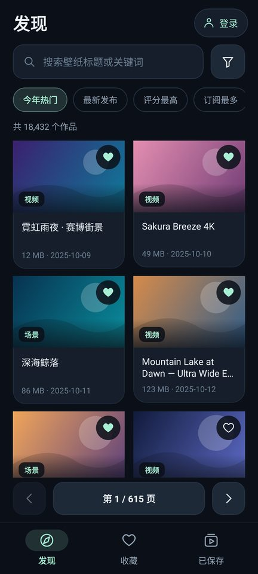
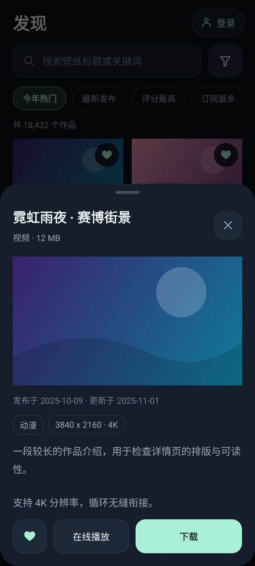
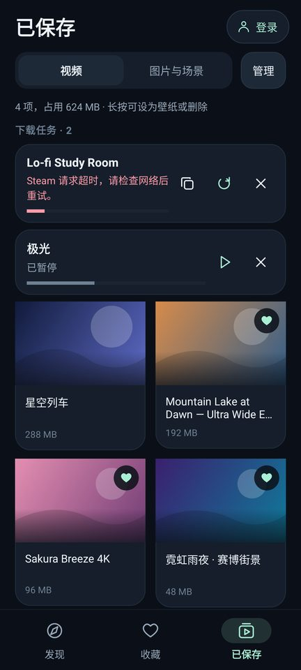

# WallpaperMobile

**在 Android 手机上浏览、下载 Steam 创意工坊里的 Wallpaper Engine 壁纸，直接设为动态壁纸。不需要开电脑。**

Android 10 及以上 · 视频 / 图片 / 部分场景 · 下载内容只保存在应用内

  
  
  

界面示意图，封面为示例图片。

## 能做什么

**找壁纸**
- 按关键词搜索创意工坊，按热门、最新、评分或订阅数排序。
- 按类型、年龄分级、分辨率和题材标签筛选，筛选条件会自动记住。
- 查看作品的 5 分制评分、评价人数和公开评论，登录后可以好评或差评；看到喜欢的点一下爱心收藏。

**下载与观看**
- 后台下载，可随时暂停、继续或取消；暂停后继续会从中断处接着下载。
- 视频作品可以不下载、直接在线播放。
- 内置播放器：拖动进度、倍速、长按加速、双指缩放，左侧上下滑调亮度、右侧调音量。

**设为壁纸**
- 视频壁纸：静音循环播放，可调播放速度、镜像、亮度、对比度、饱和度、色相和画面位置。
- 图片和场景壁纸：随手机倾斜产生视差，左右翻桌面时背景跟着移动；部分场景支持按住屏幕查看另一层画面（X-ray）。
- 设置前可以全屏预览效果。桌面和锁屏可以分别设置。
- 开启「省电时保持静态画面」后，手机进入省电模式时壁纸会停在当前画面。

## 支持哪些壁纸

| 类型 | 支持情况 |
| --- | --- |
| 视频 | ✅ 完整支持：在线播放、下载、设为动态或静态壁纸 |
| 图片、GIF、动态 WebP | ✅ 完整支持 |
| 场景（Scene） | ⚠️ 大部分支持：图片、动图和视频图层，父子图层与合成层，骨骼动画，粒子，文字与时钟，场景脚本，作者设置，X-ray，以及作者添加的特效（包括光线、模糊、泛光等多步骤特效）；不支持 3D 模型和音频响应。画面为全屏视频的场景保存为视频壁纸 |
| 网页（Web）、应用（Application） | ❌ 不支持，手机上没有对应的运行环境 |

**场景在手机上和电脑上一样吗？**
大部分效果都能保留：作者添加的特效（摇晃、波动、流水、光线、模糊、泛光等）直接运行作品自带的着色器；骨骼动画、粒子、视频图层、X-ray 按原作运行；时钟、点击切换、悬停显示等场景脚本在隔离环境中运行，触摸代替鼠标；作者在电脑上提供的设置（开关、颜色、文字、自定义图片）可以在「效果调节 → 作品设置」里修改。目前还不支持的有：3D 模型、音频响应（随音乐跳动的效果），以及少数尚未适配的特效和粒子渲染方式。这些内容在下载时会被去掉，其余部分照常运行。在「已保存」中长按场景，选择「查看转换说明」，可以看到保留和去掉了哪些内容。

特效需要系统 WebView 支持隔离的 JavaScript 运行环境（较新的 Android 手机都支持）和 OpenGL ES 3.0。

## 安装

1. 在 [Releases](https://github.com/XiongFangzhou/WallpaperMobile/releases) 下载最新的 `WallpaperMobile-x.y.z.apk`。
2. 在手机上打开安装包。系统提示“未知来源”时，允许本次安装。
3. 以后更新时直接安装新版本，登录状态、收藏和已下载的内容都会保留。

**需要准备：** 浏览和收藏可以不登录（选择「先公开浏览」）；下载和在线播放需要登录一个**已购买 Wallpaper Engine 的 Steam 账号**。

## 快速上手

1. 打开应用，点「登录 Steam」，或者先「公开浏览」。
2. 在「发现」中搜索或浏览，点开作品查看详情。
3. 点「下载」，进度显示在「已保存」页顶部。
4. 下载完成后，在「已保存」中**单击**播放或预览，**长按**选择「设为壁纸」。
5. 在设置页调整效果，全屏预览确认后点设置按钮，按系统提示完成。

## 常见问题

**登录安全吗？**
应用直接连接 Steam 官方服务器。密码只发送给 Steam，不会保存在手机上；保持登录用的是 Steam 发放的登录凭据，使用 Android Keystore 加密保存。需要验证时，在 Steam App 中确认或输入验证码即可。

**下载的内容在哪里？**
在应用的私有目录中，不会出现在相册里。卸载应用或清除应用数据会一并删除。

**翻桌面时壁纸不跟着动，或者动得不准？**
部分桌面不会把翻页位置告诉壁纸。可以在右上角菜单「通用设置」中打开「桌面滑动兼容」，或开启「精确桌面同步」（只读取桌面的滚动位置，不读取屏幕内容）。HyperOS 用户可参考 [HyperOS 原生滚动分析](docs/hyperos-native-scroll-analysis.md)。

**应用需要哪些权限？**
网络（连接 Steam）、通知和前台服务（显示并保持后台下载）、设置壁纸、调节音量（播放器手势）。精确桌面同步是可选的无障碍服务，需要你手动开启。详见[权限说明](docs/android-permissions.md)。

## 许可与声明

WallpaperMobile 源代码以 [MIT 许可证](LICENSE) 发布。

应用使用的开源组件及其许可证见 [THIRD_PARTY_NOTICES](android/assets/THIRD_PARTY_NOTICES.txt) 和 [android/assets/licenses](android/assets/licenses)，安装包内附带相同文件。

WallpaperMobile 是独立的第三方项目，与 Valve、Steam、Wallpaper Engine 及其开发者没有关联。Steam 和 Wallpaper Engine 是各自所有者的商标。创意工坊作品的版权归原作者所有，请只下载和使用你有权使用的内容。

## 开发者

从源码构建、运行检查的方法见 [开发与构建](docs/development.md)。其他文档：

- [架构与目录](docs/architecture-options.md)
- [格式与壁纸效果](docs/multiformat-and-effects.md)
- [在线播放与下载管理](docs/streaming-and-download-controls.md)
- [版本记录](docs/CHANGELOG.md)
- [贡献与 Git 工作流](docs/git-workflow.md)
