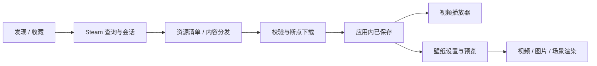

# 架构与目录

WallpaperMobile 在 Android 端直接连接 Steam，完成工坊查询、会话恢复、清单下载、数据块校验和本地资源管理。

## 数据流程

- 工坊查询、下载规划、路径约束及交互几何放在平台无关核心中。
- Android 界面使用原生组件；视频播放基于 Media3，壁纸渲染结合 MediaPlayer、OpenGL ES 与 Canvas。
- 图片场景下载后转换为手机运行版本。视频、图片与图层场景共用设置模型和预览流程。
- 登录令牌使用 Android Keystore 加密；资源存入应用私有目录。

## 目录

| 目录 | 内容 |
| --- | --- |
| `android/src/dev/workshopvideo` | 原生界面、播放与壁纸引擎 |
| `android/src/dev/workshopvideo/core` | Steam 会话、查询、下载及平台无关逻辑 |
| `android/test` | 离线核心检查 |
| `android/test-host` | 平台替身及 Android 原生图形检查 |
| `android/test-device` | 完整 Android 模拟器测试 |
| `tools` | 构建、依赖恢复、测试与样本分析工具 |
| `bridge` / `web` | 早期可选电脑中转实验，主线 Android 应用独立运行 |
| `docs` | 功能、构建与开发文档 |

## 开发配置

JDK 通过 `JAVA_HOME` 或 `WVB_JDK` 配置。外部测试样本通过 `WVB_WORKSHOP_DIR` 指向工坊内容目录；流式集成测试使用 `WVB_TEST_VIDEO` 与 `WVB_TEST_MANIFEST`；可选 Steamworks 实验使用 `WVB_STEAM_DLL` 或命令行参数。

这些配置仅在开发环境中保存，仓库提供相对目录和环境变量入口。
